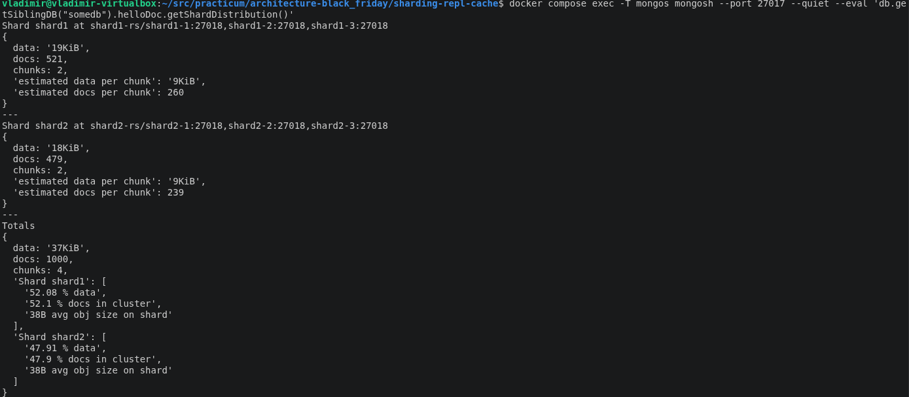
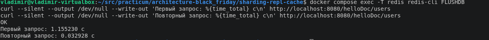

# Black Friday: шардирование и репликация MongoDB

Репозиторий содержит три варианта стенда для `pymongo-api`:

- [`mongo-sharding`](mongo-sharding) — два шарда, по одному узлу в каждом;
- [`mongo-sharding-repl`](mongo-sharding-repl) — два шарда, по три узла в каждом;
- [`sharding-repl-cache`](sharding-repl-cache) — шардирование, репликация и Redis.

Для итоговой проверки нужно запускать `sharding-repl-cache`. В README промежуточных стендов отдельно описана их инициализация.

## Схемы

Все пять вариантов находятся в [`task1.drawio`](task1.drawio). Экспортированные схемы:

1. 
2. 
3. 
4. 
5. 

## Требования

- Docker с поддержкой Docker Compose;
- не менее 2 CPU и 4 ГБ памяти;
- свободный порт `8080`;
- `curl` для проверки API;
- `jq` необязателен, но с ним удобнее читать JSON.

## Запуск итогового стенда

1. Перейдите в директорию финального варианта и запустите контейнеры:

   ```shell
   cd sharding-repl-cache
   docker compose up -d
   ```

2. Выполните инициализацию MongoDB:

   ```shell
   ./scripts/mongo-init.sh
   ```

   Скрипт по очереди настраивает `config-rs`, создаёт `shard1-rs` и `shard2-rs` по три узла, регистрирует оба шарда в `mongos`, включает шардирование `somedb.helloDoc` по хешированному `_id` и записывает 1000 тестовых документов. В конце очищается Redis, чтобы первый запрос при проверке точно прошёл через MongoDB.


## Проверка

Приложение доступно на <http://localhost:8080>, документация API — на <http://localhost:8080/docs>.

```shell
curl --silent http://localhost:8080/ | jq
curl --silent http://localhost:8080/helloDoc/count | jq
```

Корневой endpoint должен вернуть топологию `Sharded`, два шарда, `cache_enabled: true` и не меньше 1000 документов в `helloDoc`.

Состояние replica set:

```shell
docker compose exec -T shard1-1 mongosh --port 27018 --quiet --eval 'rs.status().members.forEach(member => print(member.name + ": " + member.stateStr))'
docker compose exec -T shard2-1 mongosh --port 27018 --quiet --eval 'rs.status().members.forEach(member => print(member.name + ": " + member.stateStr))'
```

В каждом наборе должен быть один `PRIMARY` и два `SECONDARY`. Распределение документов между шардами выводится так:

```shell
docker compose exec -T mongos mongosh --port 27017 --quiet --eval 'db.getSiblingDB("somedb").helloDoc.getShardDistribution()'
```


Для проверки кеша выполните один запрос дважды:

```shell
docker compose exec -T redis redis-cli FLUSHDB
curl --silent --output /dev/null --write-out 'Первый запрос: %{time_total} с\n' http://localhost:8080/helloDoc/users
curl --silent --output /dev/null --write-out 'Повторный запрос: %{time_total} с\n' http://localhost:8080/helloDoc/users
```


Первый вызов занимает около секунды, повторный должен выполниться быстрее 100 мс.

## Остановка

```shell
docker compose down
```

Чтобы удалить также данные MongoDB и Redis:

```shell
docker compose down -v
```
