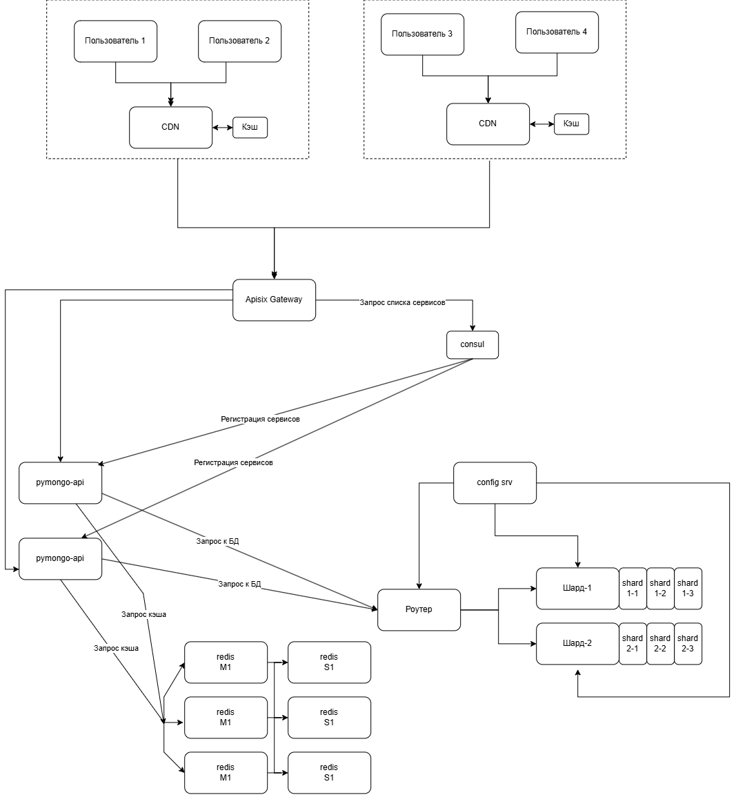

# pymongo-api

## Как запустить

Запускаем mongodb, redis и приложение из директории sharding-repl-cache

```shell
docker compose up -d
```

Заполняем mongodb данными из директории sharding-repl-cache

```shell
./scripts/repl-shard-mongo-init.sh
```
Ждем сообщения

**MongoDB cluster and Redis initialized successfully**

<br><br>

**Архитектурная схема взаимодействия сервисов онлайн магазина Мобильный мир**


